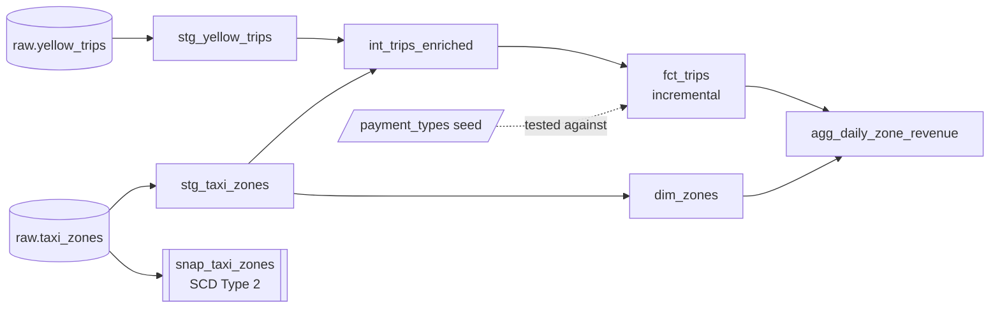

# NYC Taxi Analytics with dbt

[](https://github.com/sidpatondikar/nyc-taxi-dbt/actions/workflows/dbt_ci.yml)


I built this to learn dbt properly by modeling a real, messy dataset end to end. It takes 9.5M NYC yellow taxi trips (Jan–Mar 2024, straight from the TLC) and turns them into a small, tested star schema in DuckDB: 31 data tests, an incremental fact table that adds a month about 4× faster than a full rebuild, and CI on every push.

**[Browse the live docs and lineage graph →](https://sidpatondikar.github.io/nyc-taxi-dbt/)** (every model and column, with the SQL behind it)

It's a companion to my [NYC-Taxi-Pipeline](https://github.com/sidpatondikar/NYC-Taxi-Pipeline) project, which moves the same data with PySpark, Kafka and Airflow. That one is about getting data from A to B; this one is about modeling it so the numbers can be trusted.

## How it's laid out



- **Staging** (views): rename and cast, nothing else.
- **Intermediate** (ephemeral): zone joins, derived metrics like duration and speed, and data-quality flags.
- **Marts** (tables): a trip-level fact, a zone dimension, and a daily revenue-by-borough table.

Around that: a seed for payment-type codes, an SCD Type 2 snapshot on the zone lookup, a `safe_divide` macro, and a source freshness check. GitHub Actions runs `dbt build` on every push against a month of real data.

## What I found along the way

Most of the interesting work was deciding what to do with bad-looking data, not writing the SQL.

- **Negative fares weren't errors.** 136K rows (−$2.4M) looked like junk, but about three quarters of them exactly mirror an earlier positive row: they're refunds and disputes. Filtering fares to ≥ $0, which is what I'd done in my Spark project, keeps the original charge and drops the refund, overstating revenue by roughly $2.4M. I kept them and flagged them instead.
- **A failing test turned into a business finding.** `payment_type = 0` failed my accepted-values test. It's the TLC's code for flex-fare trips (752K trips, $14M), and those are exactly the trips with no passenger count.
- **The obvious incremental filter would have lost data.** Some trips that start just before midnight on the last day of a month show up in the next month's file, so filtering on `pickup_at > max(pickup_at)` would skip them for good. The model uses the source file's month as the watermark instead. Adding a month takes about 11 s versus 47 s for a full rebuild.
- **It caught a bug in my older project.** Joining to the real zone lookup showed my Spark pipeline had been assigning boroughs by ID range, which puts the Upper East Side in Staten Island.

My rule throughout: remove what's physically impossible (189 rows), flag what's questionable, and let each mart decide which flags matter. Revenue keeps reversals; averages use only clean trips (96% of them).

## Running it

```bash
pip install -r requirements.txt

mkdir -p data/raw
for m in 01 02 03; do
  curl -o data/raw/yellow_tripdata_2024-$m.parquet \
    https://d37ci6vzurychx.cloudfront.net/trip-data/yellow_tripdata_2024-$m.parquet
done
curl -o data/raw/taxi_zone_lookup.csv https://d37ci6vzurychx.cloudfront.net/misc/taxi_zone_lookup.csv

dbt deps
dbt build          # about a minute
dbt docs generate && dbt docs serve   # docs locally (or use the live link above)
```

## Stack and skills

**Tools:** dbt Core 1.12 (DuckDB adapter), dbt_utils, SQL, GitHub Actions, GitHub Pages.

**What it covers:** dimensional modeling (star schema, SCD Type 2), incremental models and late-arriving data, data-quality testing (generic, package and singular tests), Jinja macros, seeds, source freshness, documentation and lineage, CI.

Data from the [NYC TLC Trip Record Data](https://www.nyc.gov/site/tlc/about/tlc-trip-record-data.page).

## If I kept going

Slim CI so pull requests only build what changed, a lookback window on the incremental model for corrected files, and running the same project against Snowflake.
