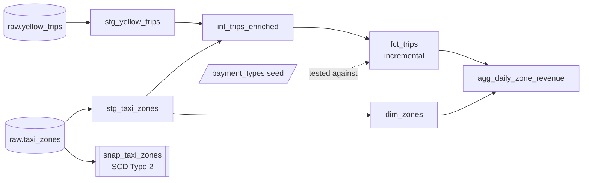

# NYC Taxi Analytics with dbt

[](https://github.com/sidpatondikar/nyc-taxi-dbt/actions/workflows/dbt_ci.yml)


I built this to learn dbt properly by modeling a real, messy dataset end to end. It takes 41M NYC yellow taxi trips (all of 2024, straight from the TLC) and turns them into a small, tested star schema: 31 data tests, an incremental fact table so a new month doesn't mean rebuilding the whole year, and CI on every push. The same models run on DuckDB on my laptop and on Snowflake.

**[Browse the live docs and lineage graph →](https://sidpatondikar.github.io/nyc-taxi-dbt/)** (every model and column, with the SQL behind it)

It's a companion to my [NYC-Taxi-Pipeline](https://github.com/sidpatondikar/NYC-Taxi-Pipeline) project, which moves the same data with PySpark, Kafka and Airflow. That one is about getting data from A to B; this one is about modeling it so the numbers can be trusted.

## How it's laid out



- **Staging** (views): rename and cast, nothing else.
- **Intermediate** (ephemeral): zone joins, derived metrics like duration and speed, and data-quality flags.
- **Marts** (tables): a trip-level fact, a zone dimension, and a daily revenue-by-borough table.

Around that: a seed for payment-type codes, an SCD Type 2 snapshot on the zone lookup, a `safe_divide` macro, and a source freshness check. GitHub Actions runs `dbt build` on every push against a month of real data.

## Running the same project on Snowflake

I started on DuckDB because it's free and runs locally, then ported the project to Snowflake as a second dbt target. The raw files go into an internal stage and are loaded with `COPY INTO`, which also records each row's file name and load time. dbt connects as a key-pair service user with a least-privilege role.

Most of the models ran unchanged. The ones that didn't used DuckDB-only syntax (`interval 1 day`, `FILTER`, `regexp_extract`, `isodow`). I swapped those for dbt's cross-database macros, plus two small `adapter.dispatch` macros of my own, so there's still one version of every model. To check the port, I ran the same query against the DuckDB tables (built with the old SQL) and the Snowflake tables (built with the new SQL). Row counts, revenue and every flag count matched exactly. The 41M-row fact table builds in about 65 seconds on an X-Small warehouse, compared with 13 minutes on my laptop. DuckDB stays the default target, and CI still runs on it.

## What I found along the way

Most of the interesting work was deciding what to do with bad-looking data, not writing the SQL.

- **Negative fares weren't errors.** 731K rows (−$16.7M across 2024) looked like junk. When I checked the first quarter, about three quarters of them exactly mirrored an earlier positive row: they're refunds and disputes. Filtering fares to ≥ $0, which is what I'd done in my Spark project, keeps the original charge and drops the refund, overstating 2024 revenue by about $16.7M. I kept them and flagged them instead.
- **A failing test turned into a business finding.** `payment_type = 0` failed my accepted-values test. It's the TLC's code for flex-fare trips (4.1M trips and $101M in 2024), and they're the only trips with no passenger count.
- **The obvious incremental filter would have lost data.** Some trips that start just before midnight on the last day of a month show up in the next month's file, so filtering on `pickup_at > max(pickup_at)` would skip them for good. The model uses the source file's month as the watermark instead. When I added April–December on top of the first quarter, the incremental load matched a full rebuild row for row (41,168,092), and a rebuild from scratch now takes about 13 minutes.
- **It caught a bug in my older project.** Joining to the real zone lookup showed my Spark pipeline had been assigning boroughs by ID range, which puts the Upper East Side in Staten Island.

My rule throughout: remove what's physically impossible or duplicated (1,628 rows in 2024), flag what's questionable, and let each mart decide which flags matter. Revenue keeps reversals; averages use only clean trips (96% of them). Those rules were written on three months of data and held up unchanged on the full year.

## Running it

```bash
pip install -r requirements.txt

mkdir -p data/raw
for m in 01 02 03 04 05 06 07 08 09 10 11 12; do
  curl -o data/raw/yellow_tripdata_2024-$m.parquet \
    https://d37ci6vzurychx.cloudfront.net/trip-data/yellow_tripdata_2024-$m.parquet
done
curl -o data/raw/taxi_zone_lookup.csv https://d37ci6vzurychx.cloudfront.net/misc/taxi_zone_lookup.csv

dbt deps
dbt build          # the full year takes a while; download fewer months for a quick run
# Snowflake: load raw.yellow_trips / raw.taxi_zones, set SNOWFLAKE_ACCOUNT, SNOWFLAKE_USER
# and SNOWFLAKE_PRIVATE_KEY_PATH, then: dbt build --target snowflake
dbt docs generate && dbt docs serve   # docs locally (or use the live link above)
```

## Stack and skills

**Tools:** dbt Core 1.12 (DuckDB and Snowflake adapters), Snowflake, DuckDB, dbt_utils, SQL, GitHub Actions, GitHub Pages.

**What it covers:** dimensional modeling (star schema, SCD Type 2), incremental models and late-arriving data, data-quality testing (generic, package and singular tests), Jinja macros and `adapter.dispatch`, cross-database SQL, Snowflake loading (stages, `COPY INTO`) and key-pair auth, seeds, source freshness, documentation and lineage, CI.

Data from the [NYC TLC Trip Record Data](https://www.nyc.gov/site/tlc/about/tlc-trip-record-data.page).
